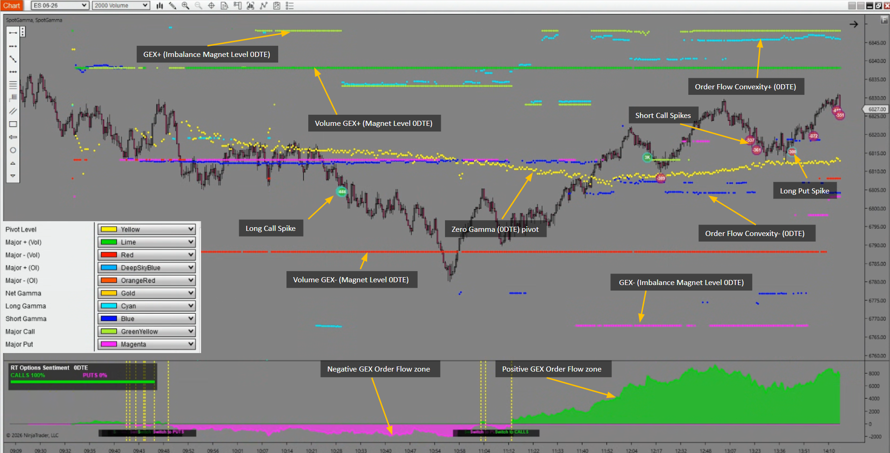

# Contenido educativo: cómo leer el flujo de opciones con RT Magneto

Este archivo convierte el material educativo que entregó el usuario en contenido listo para la web. Todo lo que aparece aquí sale de las cuatro fuentes de origen y de una captura anotada del indicador; no se añadieron resultados, cifras de rendimiento ni testimonios. Las tasas de acierto que aparecen en una de las fuentes se dejan fuera del copy a propósito (ver sección 13).

**Fuentes** (tres presentaciones en inglés generadas con NotebookLM, solo imágenes, y una conversación de ChatGPT en español):

| Archivo | Tema | Diapositivas |
|---|---|---|
| [`source/Decoding_Options_Order_Flow.pdf`](source/Decoding_Options_Order_Flow.pdf) | Cómo leer cada "spike" de flujo de opciones: convexidad (anillo exterior) + GEX (círculo interior) | 13 |
| [`source/Gamma_Market_Microstructure.pdf`](source/Gamma_Market_Microstructure.pdf) | Cómo ese flujo se agrega en regímenes de mercado y niveles en el gráfico: Zero Gamma, imanes de desequilibrio, sentimiento | 12 |
| [`source/GEX_Playbook_Market_Structure_Trading.pdf`](source/GEX_Playbook_Market_Structure_Trading.pdf) | Guía práctica: opciones como "sala de máquinas" de los futuros, regímenes gravedad/aceleración, los 3 niveles clave, 4 escenarios, tipos de entrada, disciplina, Vega y Skew. Lleva la marca "Retail TraderPro" | 15 |
| [`source/chatgpt_trading_futuros_sp500_0dte.md`](source/chatgpt_trading_futuros_sp500_0dte.md) | Conversación de ChatGPT "Trading futuros SP500 0DTE": Zero Gamma como pivote, 0DTE frente a 98DTE, fuerza relativa de Max GEX+ / Zero Gamma / Max GEX−, qué es un 0DTE, griegas, cuándo domina gamma, imán frente a soporte/resistencia | 12 respuestas |

La captura anotada por el usuario está en [`assets/rt-magneto-ninjatrader-anotado.png`](assets/rt-magneto-ninjatrader-anotado.png) y se cita como **[IMG]**.

En adelante se citan como **[OF n]** (Order Flow, diapositiva n), **[GM n]** (Gamma Microstructure, diapositiva n), **[PB n]** (GEX Playbook, diapositiva n) y **[CG]** (conversación de ChatGPT, por tema). La conversación es texto generado por IA: se usa para ampliar y explicar, no como fuente de datos, y sus afirmaciones dudosas están marcadas en la sección 13.

---

## 1. La idea central en una frase

El flujo de órdenes de opciones, leído orden a orden, revela convicción y expectativa de volatilidad; agregado por niveles de precio, define cómo cubren los dealers y dibuja en el gráfico los niveles que actúan como soporte, resistencia e imanes del precio. [GM 2]

Tres capas, de lo micro a lo macro [GM 2]:

1. **Lo micro: el flujo de órdenes de opciones (los "spikes").** Cada orden individual revela convicción y volatilidad esperada.
2. **La agregación: el posicionamiento (GEX / convexidad).** El flujo agregado define el régimen de cobertura de los dealers.
3. **Lo macro: la acción del precio (pivotes / imanes).** El posicionamiento crea límites visibles en el gráfico.

---

## 2. Glosario (para tooltips o una sección de "conceptos")

- **Flujo de órdenes de opciones (order flow):** las órdenes de compra y venta de opciones que llegan al mercado. [GM 2]
- **Spike:** cada punto de datos del flujo que aparece en el gráfico. Tiene dos capas de información. [GM 3]
- **Convexidad:** indica el tipo de posición (larga o corta) y la magnitud de la volatilidad esperada. Se muestra en el **anillo exterior**. [OF 2]
  - **Convexidad positiva (cian / long):** flujo de *compra* de opciones. [OF 3]
  - **Convexidad negativa (morado / short):** flujo de *venta* de opciones. [OF 3]
- **Exposición gamma (GEX):** identifica el sesgo de la clase de opción (call o put) y la exposición direccional. Se muestra en el **círculo interior**. [OF 2]
  - **GEX+ (verde):** dinámica del lado call. [OF 5]
  - **GEX− (rojo):** dinámica del lado put. [OF 5]
- **Zero Gamma (pivote):** la línea donde la exposición gamma agregada de los dealers cambia de positiva a negativa. [GM 8]
- **Imán de desequilibrio (Imbalance Magnet):** nivel con interés abierto de opciones muy alto que atrae al precio por la densidad de liquidez. [GM 9]
- **Volume GEX:** niveles de GEX calculados por volumen; aparecen junto a los imanes de desequilibrio en el gráfico. [GM 7, GM 11]
- **0DTE:** opciones que vencen el mismo día. Las diapositivas muestran Zero Gamma y los imanes de desequilibrio para 0DTE. [GM 7]
- **Max GEX+ ("el muro"):** el nivel de mayor GEX positivo; actúa como imán que atrae al precio y a menudo provoca giros. Es la cima de la "zona de gravedad". [PB 5]
- **Max GEX− ("el vacío"):** nivel donde el precio puede acelerar con fuerza; objetivo en tendencia bajista y posible plataforma de aceleración si se rompe. [PB 5]
- **Dealers largos / cortos de gamma:** en GEX+ los dealers están largos de gamma; en GEX− están cortos de gamma. [PB 4]
- **Vega (volatilidad implícita, IV):** el "dial de intensidad" que se superpone a la estructura GEX. [PB 14]
- **Skew:** el sesgo direccional del mercado según el precio relativo de puts y calls. [PB 14]
- **Gamma Flip:** otro nombre del nivel Zero Gamma; el precio donde la gamma neta de los dealers pasa de positiva a negativa (Γ neta = 0). [CG]
- **90DTE:** el vencimiento de largo plazo que muestra **RT Magneto**, junto con 0DTE. Es el que se nombra en todo el copy sobre el producto. (confirmado por el usuario)
- **98DTE:** vencimiento a unos 98 días que usan algunas fuentes educativas [PB 7–10, CG] para representar la estructura de posicionamiento más lenta. No es el vencimiento de RT Magneto; aparece solo como contexto educativo citado.
- **Aceptación / rechazo:** que el precio cruce un nivel y se sostenga al otro lado (aceptación) o lo intente y vuelva rápido (rechazo). [CG]
- **Pinning:** cuando el precio "se pega" a un strike con mucho interés abierto y gamma, sobre todo cerca del vencimiento. [CG]
- **Call Wall / Put Wall:** strikes con mucha gamma del lado call (suelen actuar como resistencia) o del lado put (suelen actuar como soporte). [CG]
- **Charm:** cómo cambia el delta con el paso del tiempo; la fuente lo asocia a los rebalanceos de la última parte de la sesión. [CG]
- **MBO (Market By Order):** datos de libro de órdenes orden a orden que el playbook usa para confirmar entradas junto con el orderflow. [PB 13]

---

## 3. Anatomía del indicador RT Magneto [IMG]

Captura de RT Magneto en NinjaTrader sobre ES 06-26 (gráfico de 2000 de volumen), con cada elemento señalado por el usuario. El indicador tiene **dos partes**:

1. **El gráfico principal:** niveles y puntos de colores sobre las velas del futuro.
2. **El subgráfico "RT Options Sentiment 0DTE":** una línea/área continua que pasa de magenta a verde.

### Gráfico principal: los niveles

| Elemento (rótulo en la captura) | Color en la leyenda | Qué es | Dónde se explica |
|---|---|---|---|
| **Zero Gamma (0DTE) pivot** | Amarillo — *Pivot Level* | El nivel donde la gamma neta de los dealers cambia de signo; pivote y ancla de la sesión. | Secciones 7 y 10 [GM 8, PB 5, CG] |
| **GEX+ (Imbalance Magnet Level 0DTE)** | Verde amarillento — *Major Call* | Imán de desequilibrio positivo: el nivel de mayor exposición gamma del lado call. En la captura queda **por encima** del precio. | Sección 7 [GM 9] |
| **GEX− (Imbalance Magnet Level 0DTE)** | Magenta — *Major Put* | Imán de desequilibrio negativo: el nivel de mayor exposición del lado put. En la captura queda **por debajo** del precio. | Sección 7 [GM 9] |
| **Volume GEX+ (Magnet Level 0DTE)** | Lima — *Major + (Vol)* | Nivel GEX+ calculado con el volumen del día. | Secciones 7 y 10 [GM 7, CG] |
| **Volume GEX− (Magnet Level 0DTE)** | Rojo — *Major − (Vol)* | Nivel GEX− calculado con el volumen del día. | Secciones 7 y 10 [GM 7, CG] |
| **Order Flow Convexity+ (0DTE)** | Cian — *Long Gamma* | Puntos donde el flujo compra opciones (convexidad positiva): más expectativa de volatilidad. | Sección 5 [OF 3–4] |
| **Order Flow Convexity− (0DTE)** | Azul — *Short Gamma* | Puntos donde el flujo vende opciones (convexidad negativa): rango y estancamiento. | Sección 5 [OF 3–4] |

La leyenda incluye además *Major + (OI)* (azul cielo), *Major − (OI)* (rojo anaranjado) y *Net Gamma* (dorado), que no están rotulados en la captura (ver sección 13).

### Gráfico principal: los spikes

Círculos sobre las velas con un número dentro. Siguen la matriz de los cuatro arquetipos (sección 4):

- **Long Call Spike:** compra agresiva de calls (convexidad positiva + GEX+).
- **Long Put Spike:** compra agresiva de puts (convexidad positiva + GEX−).
- **Short Call Spikes:** venta de calls (convexidad negativa + GEX−). En la captura aparecen agrupados cerca de los máximos.

### Subgráfico: RT Options Sentiment 0DTE

- **Zona magenta (Negative GEX Order Flow zone):** el flujo total de opciones 0DTE está dominado por puts.
- **Zona verde (Positive GEX Order Flow zone):** el flujo pasa a dominio de calls.
- **Cambios de régimen:** líneas amarillas discontinuas verticales con los rótulos "Switch to PUTS" y "Switch to CALLS" marcan cuándo cambia el sentimiento.
- **Lectura en la esquina:** porcentaje de calls frente a puts (en la captura, "CALLS 100 % / PUTS 0 %").

Es el "indicador adicional de sentimiento del mercado de opciones" que describe [PRODUCT.md](../PRODUCT.md), y coincide con [GM 10].

### Lo que confirma la captura

- Los imanes de desequilibrio se comportan como dice [GM 9]: GEX+ encima del precio, como techo; GEX− debajo, como suelo. Esto refuerza la lectura de la sección 13, punto 1.
- Todos los niveles rotulados son **0DTE**. La captura no muestra niveles 90DTE (ver sección 13).

---

## 4. Anatomía de un spike: dos colores, una señal

> "Para entender el contexto, hay que leer los dos colores como uno solo." [OF 2]

Cada punto del gráfico es un nodo de información de dos capas [GM 3]:

- **Anillo exterior = convexidad** (largo vs. corto): cuánta volatilidad espera quien abre la posición.
- **Círculo interior = GEX** (call vs. put): de qué lado está la exposición.

### Cómo se forma el signo del GEX [OF 6]

La polaridad del GEX es el producto del lado de la posición por el tipo de opción:

| Posición | × | Opción | = | GEX |
|---|---|---|---|---|
| Long (+1) | × | Call (+1) | = | **GEX+ (verde)** |
| Short (−1) | × | Call (+1) | = | **GEX− (rojo)** |
| Long (+1) | × | Put (−1) | = | **GEX− (rojo)** |
| Short (−1) | × | Put (−1) | = | **GEX+ (verde)** |

### La matriz de diagnóstico: los cuatro arquetipos [OF 7–11, GM 4]

| Arquetipo | Anillo exterior | Círculo interior | Mecanismo | Lectura del mercado |
|---|---|---|---|---|
| **Long Call** | Cian | Verde | Convexidad positiva + GEX+ | Fuerte convicción en un movimiento alcista. Las mayores expectativas de volatilidad combinadas con exposición gamma positiva. |
| **Short Call** | Morado | Rojo | Convexidad negativa + GEX− | Expectativa de estancamiento o de resistencia por encima. Visión de rango, sin convicción de ruptura. |
| **Long Put** | Cian | Rojo | Convexidad positiva + GEX− | Fuerte convicción en un movimiento bajista. Alta expectativa de volatilidad con exposición direccional negativa. |
| **Short Put** | Morado | Verde | Convexidad negativa + GEX+ | Expectativa de estancamiento o de soporte sólido. Visión de rango en lugar de esperar una caída fuerte. |

### Reglas de síntesis [OF 13]

- **Cian** = largo (alta volatilidad, alta convicción).
- **Morado** = corto (estancamiento, rango).
- **Verde** = GEX+ (long call / short put).
- **Rojo** = GEX− (short call / long put).
- Siempre se combinan el anillo exterior (volatilidad) y el círculo interior (dirección) para decodificar el flujo.

---

## 5. Convexidad: el indicador de convicción

> "Lee la convexidad en términos de volatilidad, no solo de dirección." [GM 5]

**Convexidad positiva (cian, posiciones largas)** [OF 4, GM 5]
- Señala convicción clara sobre un movimiento de precio inminente.
- Indica que se espera un aumento de volatilidad.
- Representa las mayores expectativas de volatilidad del mercado.
- Aplica igual a calls largas y a puts largas.

**Convexidad negativa (morado, posiciones cortas)** [OF 4, GM 5]
- Señala falta de convicción sobre rupturas de precio.
- Sugiere estancamiento y operativa en rango.
- Indica que los participantes están cobrando prima.

### El paradigma: volatilidad antes que dirección [OF 12]

> "Míralo en términos de volatilidad, no como negativo para tendencia bajista o positivo para tendencia alcista."

1. La utilidad principal del marco es medir expectativas absolutas de volatilidad.
2. Un *Long Spike* (cian) marca la mayor probabilidad de un movimiento de precio grande, sea cual sea la dirección.

---

## 6. GEX: los regímenes de mercado

> "El GEX indica el sesgo de contrato subyacente y define el entorno del sistema." [GM 6]

**GEX positivo (verde)** [GM 6]
- Impulsado por flujo dominado por calls.
- Los dealers actúan como estabilizadores: compran las caídas y venden las subidas.
- Resulta en entornos comprimidos, de menor volatilidad.

**GEX negativo (magenta / rojo)** [GM 6]
- Impulsado por flujo dominado por puts.
- Los dealers actúan como aceleradores: venden cuando el precio cae.
- Expande los rangos y aumenta la volatilidad.

Entre los dos regímenes está el punto **Zero Gamma**. [GM 6]

---

## 7. Del dato micro al gráfico macro

Cuando las órdenes long/short se agregan en niveles de precio concretos, alteran la liquidez de los dealers y convierten datos de opciones invisibles en límites visibles en el gráfico. [GM 7]

El ejemplo de la diapositiva [GM 7] (sobre el S&P 500) muestra tres elementos:

- **Zona superior verde:** GEX+ (Imbalance Magnet Level 0DTE) / Volume GEX+.
- **Línea amarilla:** pivote Zero Gamma (0DTE).
- **Zona inferior magenta:** Volume GEX− / GEX− (Imbalance Magnet Level 0DTE).

### Zero Gamma: el filtro de régimen [GM 8]

- **Concepto:** la línea divisoria donde la exposición gamma agregada de los dealers pasa de positiva a negativa.
- **Función:** pivote principal y ancla de toda la sesión.
- **Aplicación:** si el precio se mantiene por encima, confirma un entorno estable de GEX positivo; si cae por debajo, confirma un entorno volátil de GEX negativo. Actúa como soporte o resistencia de transición.

### Imanes de desequilibrio: nodos de liquidez estructural [GM 9]

Los niveles con interés abierto de opciones muy alto actúan como imanes para el subyacente por su densidad de liquidez.

- **GEX+ (imán positivo):** funciona como resistencia por encima. La cobertura de los dealers tiende a frenar el avance del precio al acercarse a este nodo.
- **GEX− (imán negativo):** funciona como suelo de soporte por debajo, o como objetivo final de ventas institucionales aceleradas.

### Sentimiento en tiempo real: validar la tendencia [GM 10]

- **Zona de flujo GEX negativo (magenta):** el flujo total está dominado por puts y convexidad corta; el precio tiende a estar pesado, volátil o a la baja.
- **Zona de flujo GEX positivo (verde):** el flujo pasa a dominio de calls; respalda el impulso alcista y una estructura de mercado que se estabiliza.
- **Punto de transición:** da confirmación en tiempo real de los cambios intradía.

Esto encaja con el "indicador adicional de sentimiento del mercado de opciones" que ya describe [PRODUCT.md](../PRODUCT.md).

---

## 8. Aplicación: cómo usar el mapa gamma

### Ciclo de una operación [GM 11]

1. **Entradas:** usar Zero Gamma y los niveles de Volume GEX como zonas para entrar en retrocesos.
2. **Confirmación:** buscar *Long Spikes* (cian) que confirmen entradas repentinas de convicción y expansión de volatilidad en tu dirección.
3. **Toma de beneficios:** los imanes de desequilibrio (GEX+ y GEX−) son zonas terminales; como el precio tiende a frenarse en esos nodos de liquidez, sirven como objetivos para salir de la posición.

### El playbook unificado [GM 12]

1. **Lee lo micro (convicción):** detecta cambios inmediatos de convicción. Busca convexidad larga (cian) que señale expansión de volatilidad y flujo agresivo.
2. **Define el régimen (macro):** mapea el terreno. ¿El mercado está en un entorno estable (GEX+) o volátil (GEX−)? Compara el precio con el pivote Zero Gamma.
3. **Opera la estructura (ejecución):** deja de operar el precio a ciegas. Usa los imanes como objetivos de toma de beneficios y como nodos de soporte y resistencia.

---

## 9. El GEX Playbook: de la estructura a la ejecución

Esta sección resume la tercera fuente [PB], que es la más práctica. Va de la idea general al checklist de cada operación.

### La sala de máquinas y las ruedas [PB 3]

El *GEX Framework* es una metodología para anticipar la estructura y el comportamiento del mercado analizando la exposición gamma (GEX) del mercado de opciones.

- **La sala de máquinas: el mercado de opciones (SPX / NDX).** Aquí se genera la fuerza. Se usan estos datos institucionales para ver la estructura real del mercado.
- **Las ruedas: el mercado de futuros (ES / NQ).** Es lo que tú conduces; el principal motor del flujo de órdenes en futuros.

Esto encaja con el posicionamiento de [PRODUCT.md](../PRODUCT.md): RT Magneto lleva los datos de opciones (SPX, NDX…) al gráfico del futuro correspondiente (ES, NQ…).

### Operar en la niebla [PB 2]

El mercado suele sentirse como un campo de batalla aleatorio. Sin un mapa, el trader adivina, reacciona al ruido y toma decisiones emocionales en lugar de estratégicas. La pregunta que plantea la fuente: *¿y si pudieras ver la estructura oculta que mueve el precio?*

### Los dos regímenes: gravedad y aceleración [PB 4]

| | **Entorno GEX+ (zona de gravedad)** | **Entorno GEX− (zona de aceleración)** |
|---|---|---|
| Dealers | Largos de gamma | Cortos de gamma |
| Comportamiento | El mercado tiende a volver a la media | El mercado es propenso a rupturas |
| Volatilidad | Baja | Alta |
| Forma | Rango | Movimientos direccionales |
| Estrategia principal | Usar Max GEX+ como imán. Operar retrocesos hacia el nivel o desvanecer (fade) el movimiento en esos niveles. | Usar Max GEX− como imán para el objetivo. Si se rompe, tratarlo como zona de aceleración. Operar impulso y continuaciones. |

### Los 3 niveles clave [PB 5]

1. **Max GEX+ (el muro):** imán potente que atrae al precio y a menudo provoca giros.
2. **Zero Gamma (el pivote):** la línea en la arena. Cruzarla señala un posible cambio de régimen, de gravedad a aceleración o al revés.
3. **Max GEX− (el vacío):** el precio puede acelerar con fuerza. Objetivo en tendencia bajista y posible plataforma de lanzamiento si se rompe.

### Los 4 escenarios [PB 6–10, PB 15]

Se basan en la posición del precio respecto a Zero Gamma y a los niveles GEX+/−. Los ejemplos de la fuente usan ES y NQ con niveles ilustrativos.

| Escenario | Gamma de los dealers | Tipo de entrada | Objetivo primario → secundario |
|---|---|---|---|
| **1. De Zero Gamma a Max GEX+ (el tirón de la gravedad)** | Largos | Retroceso (comprar caídas) | Max GEX+ 0DTE → siguiente nivel gamma de largo plazo |
| **2. De Zero Gamma a Max GEX− (la aceleración)** | Cortos | Retroceso (vender subidas) | Max GEX− 0DTE → siguiente nivel GEX de largo plazo |
| **3. Precio en Max GEX+ (el muro)** | Largos | Fade del nivel (giro) | Zero Gamma → siguiente nivel gamma de largo plazo |
| **4. Precio en Max GEX− (el vacío)** | Cortos | Impulso (continuación) | Siguiente nivel GEX 0DTE → siguiente nivel gamma de largo plazo |

En la fuente, el "nivel de largo plazo" es un nivel 98DTE. En RT Magneto el equivalente es el nivel **90DTE**.

Ejemplos de la fuente, resumidos:

- **Escenario 1 [PB 7]:** ES cruza Zero Gamma en 4500, Max GEX+ en 4525. Esperar un retroceso a 4505–4508 para entrar largo.
- **Escenario 2 [PB 8]:** NQ rompe por debajo de Zero Gamma en 15000, Max GEX− en 14800. Esperar un ligero rechazo en la zona de Zero Gamma (p. ej. 14990–14995) para confirmar debilidad y entrar corto.
- **Escenario 3 [PB 9]:** ES toca Max GEX+ en 4525. Buscar una señal de giro (p. ej. vela con mecha) y confirmarla en el orderflow / Bookmap con stops, icebergs, sweeps y absorción.
- **Escenario 4 [PB 10]:** NQ cae hacia Max GEX− y rompe el nivel. Esperar una pequeña consolidación tras la ruptura para vender a favor del impulso.

### Tipos de entrada [PB 11]

- **Preferidas por la fuente:**
  - **Retroceso (pullback):** entrar a favor de la tendencia tras una pausa. Escenario ideal: de Zero Gamma hacia GEX+/−.
  - **Fade del nivel:** operar contra el movimiento cuando el precio toca Max GEX+.
  - **Impulso (momentum):** sumarse a la tendencia tras una breve consolidación después de la ruptura. Escenario ideal: precio en Max GEX−.
- **Desaconsejadas por la fuente:**
  - **Ruptura (breakout):** entrar cuando el precio rompe con fuerza Max GEX+.
  - **Giro (reversal):** intentar comprar una caída o vender una subida en zona GEX−.

### La regla de oro [PB 12]

> "En régimen GEX+, piensa como un contrarian. En régimen GEX−, piensa como un seguidor de tendencia."

> "La clave es adaptar tu mentalidad y tu tipo de entrada a la estructura del mercado. La línea Zero Gamma es el pivote crítico, la línea en la arena." [PB 15]

### Checklist antes de operar [PB 13]

**Checklist rápido**
1. Identificar la posición del precio respecto a Zero Gamma.
2. Determinar el escenario (4 posibles).
3. Identificar el siguiente nivel gamma clave.
4. Confirmar con datos de orderflow / MBO.
5. Aplicar el tipo de entrada adecuado.

**Gestión de riesgo (valores que propone la fuente)**
- Riesgo por operación: 1 % del capital.
- Riesgo diario máximo: 3 %.
- Máximo de posiciones simultáneas: 2.
- Tres pérdidas seguidas → parar el día.

**Cuándo NO operar**
- 30 minutos antes de datos macro (CPI, FOMC, NFP).
- Cuando el GEX es neutral o contradictorio.
- Cuando el VIX sube más de un 5 % intradía.
- Cuando el orderflow no confirma.

### Subir de nivel: Vega y Skew [PB 14]

Para una visión "3D" del mercado, se superponen la volatilidad (Vega) y el Skew a la estructura GEX.

- **Vega (IV), el dial de intensidad:** IV alta en un entorno GEX+ señala un muelle comprimido y más riesgo de ruptura. IV baja confirma un rango estable.
- **Skew, el sesgo direccional:** un skew pronunciado (puts caras) indica miedo a una caída y aumenta el riesgo de ruptura bajista. Un skew plano indica euforia (FOMO) y aumenta el riesgo de ruptura alcista.

Nota: PRODUCT.md no lista Vega ni Skew entre las griegas que muestra RT Magneto (Gamma, Delta, Vanna, Charm). Este bloque es educativo y no debe presentarse como función del producto sin confirmarlo.

---

## 10. Zero Gamma, 0DTE y la fuerza de cada nivel (ampliación) [CG]

Esta sección amplía lo anterior con la conversación de ChatGPT. Está escrita para un trader de ES/NQ y responde preguntas que las presentaciones dejan abiertas.

### Por qué las opciones mueven los futuros

- Los dealers (market makers) venden opciones y no buscan dirección: neutralizan su delta comprando o vendiendo futuros.
- La cadena es: cambia el delta de las opciones → el dealer ajusta con futuros → el futuro mueve el índice → el índice arrastra a las acciones.
- Por eso tiene sentido operar futuros con datos de opciones: el precio refleja en parte coberturas forzadas, no solo opiniones.

### Las griegas en una frase

| Griega | Piensa en… | Qué controla |
|---|---|---|
| Delta | Dirección | El flujo inmediato en futuros |
| Gamma | Aceleración | La velocidad de las coberturas y la volatilidad intradía |
| Theta | El reloj | El desgaste de la prima; en 0DTE es brutal |
| Vega | El miedo | Expansión o compresión de la volatilidad |
| Rho | Las tasas | Casi irrelevante intradía |

**Por qué gamma pesa más que delta en intradía:** delta describe dónde está el dealer ahora; gamma describe qué va a tener que hacer cuando el precio se mueva. Gamma es lo que obliga a cubrir, y explica por qué un breakout falla, por qué el precio se pega a un strike o por qué el mercado explota de repente.

**GEX** agrega gamma, interés abierto y el signo de la posición del dealer. No se miran griegas aisladas sino la exposición total.

### Qué son los 0DTE

- Opciones que vencen el mismo día en que se operan (SPX, SPY, QQQ…).
- Theta muy alto: la prima puede irse a cero en horas.
- Gamma extremo: el delta cambia con movimientos pequeños, de ahí las velas explosivas intradía.
- Efectos de mercado: pinning en strikes y movimientos bruscos cerca del cierre.
- Riesgos reales: pérdidas del 100 % en minutos, slippage, sobreoperación y FOMO.

### Zero Gamma: filtro de contexto, no gatillo

- No es una señal exacta de compra o venta; es un cambio de régimen en el flujo de cobertura. Separa el comportamiento estabilizador del amplificador.
- **Funciona mejor** en días balanceados: IV moderada, sin noticias macro, dealers dominando el flujo, régimen de gamma positiva.
- **Funciona peor** en días macro (FOMC, CPI, NFP, discursos de la Fed, grandes resultados) y en días de gamma muy negativa, donde el precio lo atraviesa varias veces.
- **Aceptación frente a rechazo:** no se entra por tocar el nivel. Long tras recuperar el flip y sostenerse encima; short tras perderlo y fallar al recuperarlo.
- **Qué lo refuerza:** delta acompañando, VIX que no contradice, Volume GEX coherente con el GEX por interés abierto, VWAP, absorción en el orderflow.
- **La hora importa:** apertura con mucho ruido; mediodía más limpio para reversión; tramo final con flujos de Charm y rebalanceo, y un flip más sensible.
- **En 0DTE el flip se mueve durante el día**, sobre todo cerca del cierre, así que hay que seguirlo en tiempo real.
- **Sesgo práctico:** por encima del flip, buscar compras en retrocesos; por debajo, ventas en rebotes.

### 0DTE frente a 98DTE: dos horizontes

La fuente compara el flip 0DTE con el de 98DTE. RT Magneto muestra **0DTE y 90DTE**, así que en la web la misma idea se explica con 90DTE como horizonte largo. Las cifras 98DTE se quedan como parte de la fuente citada.

| | Flip 0DTE | Flip 98DTE |
|---|---|---|
| Representa | El flujo y el posicionamiento del día | El posicionamiento swing / institucional |
| Carácter | Rápido, sensible, cambiante | Lento, estructural, estable |
| Uso | Táctica intradía | Estructura y sesgo direccional |

- En días normales suele dominar el 0DTE, porque la gamma crece mucho cerca del vencimiento. En días de tendencia o macro puede dominar el 98DTE.
- **Precio por encima de ambos flips:** sesgo alcista, estabilidad, compresión y pinning.
- **Precio por debajo de ambos:** sesgo bajista, expansión de volatilidad, días de tendencia.
- **Precio entre los dos:** zona de conflicto. Más chop, rupturas falsas y menos continuidad. Lo prudente es esperar a que se resuelva: recuperar el flip 0DTE y sostenerse (alcista) o perder el 98DTE y quedarse debajo (bajista).

### Qué nivel respeta más el precio (0DTE)

| Nivel | Mejor uso | Tipo de mercado | Regla práctica |
|---|---|---|---|
| **Max GEX+** | Reversión / imán | Rango, estable | "Desvanece el movimiento" |
| **Zero Gamma** | Cambio de régimen | Transición | "Opera la aceptación" |
| **Max GEX−** | Expansión / ruptura | Volátil | "Opera la aceleración" |

Según la fuente, Max GEX+ suele ser el nivel más respetado intradía, porque la cobertura trabaja contra el movimiento. Max GEX− no es buen nivel para operar giros, porque el precio puede atravesarlo con violencia.

### Imán o soporte/resistencia

Esta es la aclaración más útil para la web, porque resuelve buena parte de la duda de la sección 13:

- **En gamma positiva**, Max GEX+ funciona como **imán**: el precio vuelve a él porque los dealers compran cuando baja y venden cuando sube. Parece soporte o resistencia, pero es un punto de equilibrio.
- **En gamma negativa**, los niveles dejan de ser imanes y actúan como **soporte o resistencia reales**: por debajo del nivel, resistencia; por encima, soporte. Al tocarlo hay rechazos o rupturas fuertes.

> "En gamma positiva los niveles se parecen a soportes y resistencias; en gamma negativa de verdad lo son."

### Cuándo manda la gamma y cuándo no

| Contexto | ¿Gamma manda? |
|---|---|
| Día de vencimiento 0DTE | Sí |
| Mucho interés abierto en strikes cercanos al precio | Sí |
| GEX positivo dominante | Sí |
| VIX bajo | Sí |
| Evento macro | No |
| Ruptura sostenida del flip | No |
| Después del vencimiento | No |
| Tendencia fuerte de marco temporal mayor | No |
| Overnight / fuera de horario | Menos |

### Lo que GEX no hace

GEX no dice si el precio va a subir o bajar; dice **cómo** es probable que se mueva: en rango con GEX positivo, en tendencia con GEX negativo. Errores comunes: creer que predice dirección, ignorar el contexto macro, no esperar confirmación del precio y sobreoperar.

---

## 11. Copy listo para secciones de la landing

Textos en español, ajustados a lo que dicen las fuentes. El tono es educativo y evita prometer resultados (ver [Product Principles](../PRODUCT.md)).

### Hero

- **Titular:** Mira las fuerzas invisibles que mueven el precio.
- **Subtítulo:** RT Magneto lleva el posicionamiento del mercado de opciones a tu gráfico de futuros: exposición gamma, convexidad, el pivote Zero Gamma y los niveles que actúan como imanes del precio.
- **CTA primario:** Aprende a leer el flujo de opciones
- **CTA secundario:** Ver cómo funciona

### Sección: Tu gráfico, explicado

- **Titular:** Todo lo que ves en el gráfico, con nombre.
- **Texto:** RT Magneto pone dos capas sobre tu futuro. En el gráfico principal: el pivote Zero Gamma, los imanes GEX+ y GEX−, los niveles por volumen y los puntos de convexidad y los spikes del flujo de opciones. En el subgráfico: el sentimiento 0DTE, que pasa de magenta a verde cuando el flujo cambia de puts a calls.
- **Microcopy para hotspots** (una línea por elemento al pasar el cursor o hacer scroll):
  - *Zero Gamma:* la línea que divide la sesión.
  - *Imán GEX+:* donde la cobertura de los dealers frena las subidas.
  - *Imán GEX−:* el suelo, o el destino de las caídas aceleradas.
  - *Volume GEX±:* los mismos imanes, calculados con el volumen del día.
  - *Convexidad + / −:* quién compra y quién vende volatilidad.
  - *Spikes:* las órdenes grandes de opciones, en el momento en que entran.
  - *Sentimiento 0DTE:* magenta, dominan los puts; verde, dominan las calls.

### Sección: De lo micro a lo macro

- **Titular:** De cada orden al mapa del mercado.
- **Texto:** Cada orden de opciones revela convicción y volatilidad esperada. Agregadas por nivel de precio, definen cómo cubren los dealers. Y esa cobertura dibuja en el gráfico los soportes, resistencias e imanes que encuadran la sesión.
- **Tres pasos:** Flujo de órdenes → Posicionamiento (GEX / convexidad) → Acción del precio (pivotes / imanes).

### Sección: Anatomía de un spike

- **Titular:** Dos colores. Una sola señal.
- **Texto:** Cada punto tiene dos capas. El anillo exterior indica la convexidad: si el flujo compra o vende opciones y cuánta volatilidad espera. El círculo interior indica el GEX: si la exposición es del lado call o del lado put. Se leen juntos.

### Sección: Los cuatro arquetipos

- **Titular:** Cuatro combinaciones para leer el flujo institucional.
- **Tarjetas:**
  - **Long Call** (cian + verde): convicción alcista y alta volatilidad esperada.
  - **Long Put** (cian + rojo): convicción bajista y alta volatilidad esperada.
  - **Short Call** (morado + rojo): estancamiento o resistencia por encima; sin convicción de ruptura.
  - **Short Put** (morado + verde): estancamiento o soporte sólido; visión de rango.

### Sección: Volatilidad antes que dirección

- **Titular:** No preguntes solo hacia dónde. Pregunta cuánto.
- **Texto:** La convexidad se lee en términos de volatilidad. Un spike cian marca la mayor expectativa de un movimiento grande, sea al alza o a la baja. Un spike morado apunta a rango y estancamiento.

### Sección: Regímenes de mercado (GEX)

- **Titular:** Amortiguador o acelerador.
- **Texto:** Con GEX positivo, los dealers compran las caídas y venden las subidas, y la volatilidad se comprime. Con GEX negativo, venden cuando el precio cae, y los rangos se expanden. Saber en qué régimen estás cambia cómo lees cada movimiento.

### Sección: Zero Gamma

- **Titular:** La línea que divide la sesión.
- **Texto:** Zero Gamma es el nivel donde la exposición gamma de los dealers cambia de signo. Por encima, entorno estable; por debajo, entorno volátil. Es el pivote y ancla de la sesión.

### Sección: Imanes de desequilibrio

- **Titular:** Donde se concentra la liquidez, el precio responde.
- **Texto:** Los niveles con mayor interés abierto en opciones actúan como imanes. El imán GEX+ tiende a frenar las subidas; el imán GEX− funciona como suelo o como destino de las ventas aceleradas.

### Sección: Sentimiento en tiempo real

- **Titular:** Confirma el cambio cuando ocurre.
- **Texto:** El indicador de sentimiento muestra si el flujo total está dominado por puts (magenta) o por calls (verde). El punto de transición da confirmación en tiempo real de los cambios intradía.

### Sección: Operar en la niebla (problema)

- **Titular:** ¿Operando en la niebla?
- **Texto:** Sin un mapa, el mercado parece aleatorio: indicadores que se contradicen, ruido y decisiones emocionales. Debajo del precio hay una estructura que se puede ver.

### Sección: La sala de máquinas

- **Titular:** El mercado tiene una sala de máquinas.
- **Texto:** La fuerza se genera en las opciones (SPX, NDX). Tú conduces el futuro (ES, NQ). RT Magneto conecta las dos cosas y pone en tu gráfico de futuros la estructura que viene del mercado de opciones.

### Sección: Gravedad o aceleración

- **Titular:** Dos regímenes. Dos formas de pensar.
- **Texto:** En la zona de gravedad (GEX+), los dealers están largos de gamma, la volatilidad baja y el precio tiende a volver a la media. En la zona de aceleración (GEX−), están cortos de gamma y el mercado es propenso a rupturas y movimientos direccionales.
- **Cita destacada:** "En GEX+, piensa como un contrarian. En GEX−, piensa como un seguidor de tendencia."

### Sección: Los 3 niveles clave

- **Titular:** Conoce tu campo de batalla.
- **Tarjetas:**
  - **El muro (Max GEX+):** imán que atrae al precio y a menudo provoca giros.
  - **El pivote (Zero Gamma):** la línea en la arena; cruzarla puede cambiar el régimen.
  - **El vacío (Max GEX−):** donde el precio puede acelerar.

### Sección: Los 4 escenarios

- **Titular:** Cuatro escenarios. Un mapa para cada uno.
- **Texto:** Según dónde esté el precio respecto a Zero Gamma y a los niveles GEX, cambian la entrada y los objetivos: retroceso hacia el imán, venta del rebote en aceleración, fade en el muro o impulso en el vacío.
- **Nota:** sin porcentajes de acierto (ver sección 13).

### Sección: Disciplina

- **Titular:** Saber cuándo no operar también es estructura.
- **Texto:** Antes de cada operación: posición frente a Zero Gamma, escenario, siguiente nivel clave y confirmación en el orderflow. Y reglas claras para quedarse fuera: antes de datos macro, con GEX neutral o contradictorio, o cuando el orderflow no confirma.

### Sección: Por qué las opciones mueven tu futuro

- **Titular:** El precio no se mueve porque quiere.
- **Texto:** Los dealers venden opciones y se cubren con futuros. Cada vez que el precio se mueve, tienen que comprar o vender ES y NQ. RT Magneto te muestra dónde esas coberturas frenan el precio y dónde lo aceleran.

### Sección: Imán o muro

- **Titular:** El mismo nivel, dos comportamientos.
- **Texto:** En gamma positiva, Max GEX+ es un imán: el precio vuelve a él. En gamma negativa, los niveles se convierten en soporte y resistencia reales, y el precio rebota o los rompe con fuerza. Saber en qué régimen estás cambia cómo lees el nivel.

### Sección: 0DTE y 90DTE

- **Titular:** El día y la estructura.
- **Texto:** RT Magneto muestra dos horizontes: 0DTE, el flujo del día, y 90DTE, la estructura de fondo. Cuando el precio está por encima o por debajo de los dos, los movimientos suelen ser más limpios. Entre ambos, el mercado duda.

### Sección: Zero Gamma no es un gatillo

- **Titular:** No entres por tocar la línea.
- **Texto:** Zero Gamma es un filtro de contexto. Espera a que el precio lo acepte o lo rechace, y confírmalo con el orderflow, el delta y el VIX antes de actuar.

### Sección: El método en tres pasos

- **Titular:** Lee. Define. Opera.
- **1. Lee lo micro:** detecta cambios de convicción en el flujo.
- **2. Define el régimen:** compara el precio con Zero Gamma para saber si el entorno es estable o volátil.
- **3. Opera la estructura:** usa los imanes como objetivos y como niveles de soporte y resistencia, en lugar de operar el precio a ciegas.

---

## 12. Estructura sugerida para la landing con scroll 3D

Propuesta de orden narrativo, siguiendo el principio "educar para vender" de [PRODUCT.md](../PRODUCT.md). Las ideas visuales salen de los diagramas de las fuentes.

| # | Sección | Idea visual 3D / scroll | Fuente |
|---|---|---|---|
| 1 | Hero | Precio en movimiento rodeado de puntos cian y morados que aparecen al hacer scroll | GM 1, OF 1 |
| 2 | Operar en la niebla | Un gráfico cubierto de indicadores y niebla que se despeja al hacer scroll y deja ver soporte y resistencia | PB 2 |
| 3 | La sala de máquinas | Un motor (opciones SPX/NDX) que transmite energía a las ruedas (futuros ES/NQ); los dealers aparecen como la transmisión | PB 3, CG |
| 3b | Tu gráfico, explicado | La captura real del indicador; al hacer scroll se iluminan uno a uno sus elementos con el microcopy de hotspots | IMG |
| 4 | De lo micro a lo macro | Los spikes se agrupan en un perfil de GEX por strike y después se proyectan como líneas en el gráfico | GM 2 |
| 5 | Anatomía de un spike | El anillo exterior y el círculo interior se separan en el espacio y se vuelven a unir | GM 3, OF 2 |
| 6 | Los cuatro arquetipos | Matriz 2×2 que se construye combinando anillos (cian/morado) y núcleos (verde/rojo) | OF 6–11, GM 4 |
| 7 | Volatilidad antes que dirección | Contraste flecha alcista/bajista frente a radar de volatilidad | OF 12 |
| 8 | Gravedad o aceleración | Imán (GEX+) frente a cohete (GEX−), con Zero Gamma en el centro | GM 6, PB 4, PB 12 |
| 9 | Los 3 niveles clave | Muro, pivote y vacío como tres planos horizontales que el precio atraviesa; el plano de Max GEX+ cambia de imán a muro según el régimen | PB 5, GM 8, GM 9, CG |
| 9b | 0DTE y 90DTE | Dos líneas de flip a distinta profundidad (0DTE y 90DTE, los vencimientos de RT Magneto); el precio entre ambas tiembla, fuera de ellas fluye | CG, PRODUCT.md |
| 10 | Sentimiento | Área magenta que pasa a verde en el punto de transición | GM 10 |
| 11 | Los 4 escenarios | Cuatro mini-gráficos animados (retroceso, rechazo, fade, impulso) | PB 6–10, PB 15 |
| 12 | El método y la disciplina | Ciclo de operación y checklist que se marca al hacer scroll | GM 11, GM 12, PB 13 |
| 13 | Producto y plataformas | Mercados, griegas y plataformas tal como figuran en PRODUCT.md | PRODUCT.md |
| 14 | Captación | Canales (YouTube, TikTok, Telegram) y formulario propio | PRODUCT.md |
| 15 | Aviso de riesgo | Texto pendiente de aprobación del usuario | PRODUCT.md |

**Paleta que usan las fuentes** (útil para mantener coherencia con el indicador): cian = convexidad larga, morado = convexidad corta, verde = GEX+, rojo/magenta = GEX−, amarillo = Zero Gamma. El GEX Playbook usa otra paleta (naranja = GEX+ / gravedad, magenta = GEX− / aceleración, verde agua = Zero Gamma); conviene elegir una sola para la web.

---

## 13. Puntos a confirmar con el usuario antes de publicar

1. **Contradicción de soporte/resistencia (en parte resuelta).** [GM 9] dice que el imán GEX+ actúa como *resistencia* y el GEX− como *soporte*. Pero el diagrama de [GM 2] etiqueta la resistencia como "Negative GEX magnet" y el soporte como "Positive GEX pivot". [CG] lo explica según el régimen: en gamma positiva Max GEX+ es un imán, y en gamma negativa los niveles actúan como soporte o resistencia según el precio esté encima o debajo. El copy sigue esa lectura; falta confirmar que [GM 2] es solo un diagrama ilustrativo.
2. **Lenguaje que puede sonar a promesa de resultados.** Las fuentes usan expresiones como "high-probability zones", "inevitable profit-taking targets", "ultimate, objective targets" o "mathematically validates". Este archivo las suaviza ("zonas para entrar", "sirven como objetivos", "respalda") para cumplir con no implicar resultados. Si el usuario quiere mantenerlas, conviene revisarlas junto con el aviso de riesgo.
3. **Mercado de los ejemplos.** Los ejemplos de las fuentes son sobre el S&P 500. Confirmar si se pueden presentar como ES en la web o si conviene añadir ejemplos de NQ, RTY, YM, GC o CL.
4. **Capturas reales.** [GM 7] y [GM 8] parecen capturas del indicador en un gráfico. Confirmar si se pueden usar como imágenes en la web y si hay capturas de NinjaTrader o ATAS en mejor resolución.
5. **Nombres de los elementos en el indicador.** Confirmar los nombres exactos que muestra RT Magneto ("Imbalance Magnet Level", "Volume GEX", "Zero Gamma") y si se dejan en inglés o se traducen en la web.
6. **Origen del material.** Las presentaciones están generadas con NotebookLM y llevan su marca de agua. Confirmar si se pueden mostrar tal cual o solo como fuente interna.
7. **Tasas de acierto del 70–80 % (y 20–30 %).** [PB 6–11, PB 15] atribuyen a cada escenario una "success rate" del 70–80 %, y del 20–30 % a las entradas de ruptura y giro. No hay datos que las respalden en el material, y PRODUCT.md prohíbe implicar resultados, así que no aparecen en el copy. Si el usuario quiere usarlas, harían falta datos verificables, metodología y un aviso de riesgo claro, y aun así es recomendable no publicarlas.
8. **Marca "Retail TraderPro".** El GEX Playbook lleva el logo de Retail TraderPro, no de RT Magneto. Confirmar si es una marca del usuario (¿"RT" = Retail Trader?) o de un tercero, antes de reutilizar su material o mencionarla.
9. ~~**98DTE frente a 90DTE.**~~ **Resuelto:** RT Magneto usa **90DTE**. El 98DTE del playbook y de [CG] es de otros vencimientos y se mantiene solo como contexto educativo citado; el copy sobre el producto habla siempre de 0DTE y 90DTE.
10. **Max GEX+ como resistencia frente a "zona de gravedad".** [PB 4–5] describe Max GEX+ como imán que atrae y provoca giros, y Max GEX− como zona de aceleración que puede romperse. Es coherente con [GM 9], pero refuerza la duda del punto 1 sobre [GM 2].
11. **Reglas de riesgo concretas.** Los valores de [PB 13] (1 % por operación, 3 % diario, 2 posiciones, VIX > 5 %) son recomendaciones de la fuente. Confirmar si el usuario quiere publicarlos como guía educativa o dejarlos solo en materiales del curso.
12. **Vega y Skew.** Confirmar si RT Magneto muestra IV o Skew; si no, presentarlos solo como concepto educativo.
13. **Afirmaciones de [CG] que no deben publicarse tal cual.** La conversación es texto de IA y mezcla buenas explicaciones con frases dudosas:
    - "El 90 % de los traders retail pierde aquí": cifra sin fuente; fuera del copy.
    - "Sí tiene edge estadístico", "probabilidad muy alta", "movimiento violento casi seguro", "puedes generar retornos muy altos": promesas implícitas de resultado; fuera del copy.
    - "Gamma no se puede cubrir": impreciso (se puede cubrir con otras opciones); no se usa.
    - "Γ ∝ 1/T": simplificación; no se usa como fórmula en la web.
    - Herramientas de terceros (SpotGamma, SqueezeMetrics, Tradytics, Thinkorswim): no se mencionan en la web.
    - Stops y objetivos en porcentaje del "Trading System" (0,3 %–1,5 %) y estrategias de venta de prima (iron condor, credit spreads): son consejo operativo concreto; fuera del copy salvo que el usuario quiera un apartado de formación con aviso de riesgo.
14. **Volume GEX frente a GEX por interés abierto.** [CG] dice que cuando el Volume GEX diverge del GEX por interés abierto, el posicionamiento real puede estar cambiando. Encaja con la "escalera de gamma por volumen y por desequilibrio" de PRODUCT.md; confirmar si RT Magneto muestra ambas versiones para poder explicarlo en la web.
15. **Rótulo "SpotGamma" en la captura.** Arriba a la izquierda del gráfico se lee "SpotGamma, SpotGamma" (nombre del indicador o de la plantilla en NinjaTrader). Antes de publicar la imagen conviene recortarla o volver a capturarla sin ese rótulo, para no mencionar a un tercero ni sugerir que RT Magneto usa sus datos. Confirmar también de dónde vienen los datos de opciones.
16. **Elementos de la leyenda sin rótulo.** Confirmar qué muestran *Major + (OI)*, *Major − (OI)* y *Net Gamma*, y si deben aparecer en la web.
17. **Números dentro de los spikes.** Confirmar qué indican (444, 3K, −537…): ¿contratos, prima, delta?
18. **Niveles 90DTE.** La captura solo muestra niveles 0DTE. Confirmar cómo se ven los niveles 90DTE en el indicador para documentarlos igual.
19. **Captura en ATAS.** Si hay una captura equivalente en ATAS, sirve para mostrar en la web las dos plataformas disponibles.
